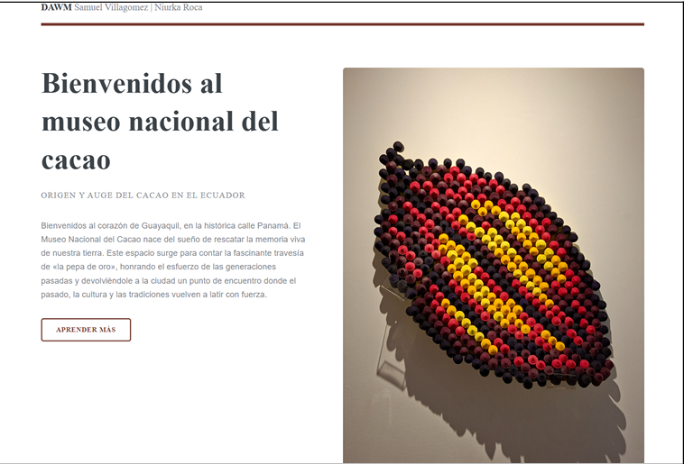
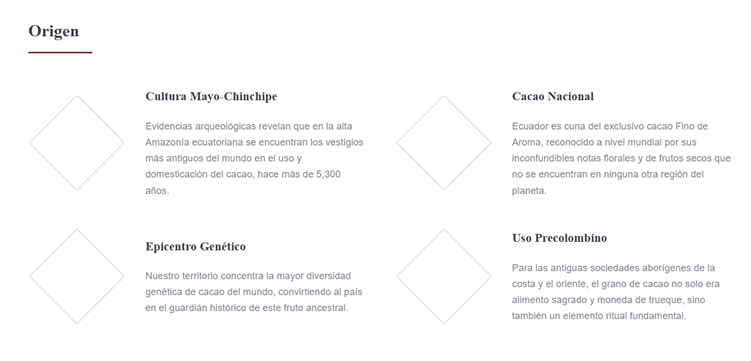
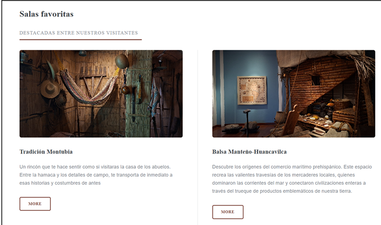
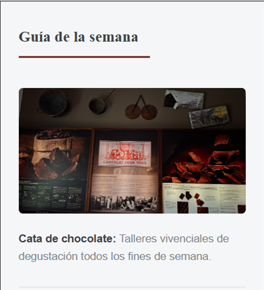
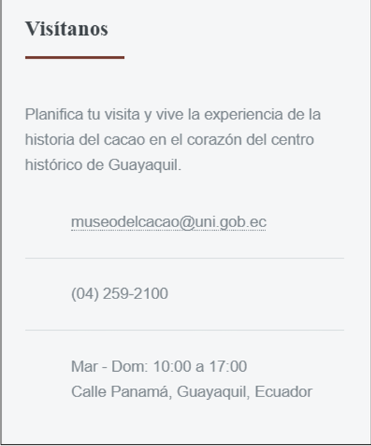
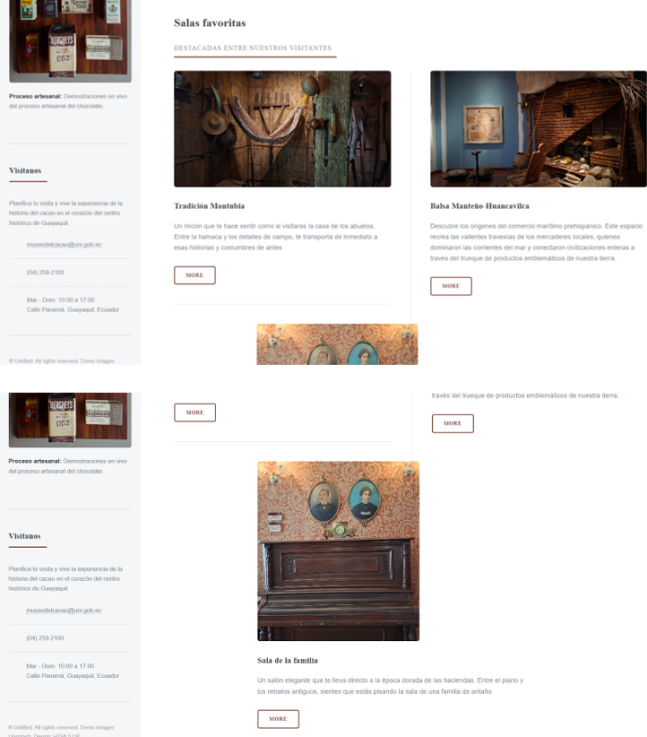
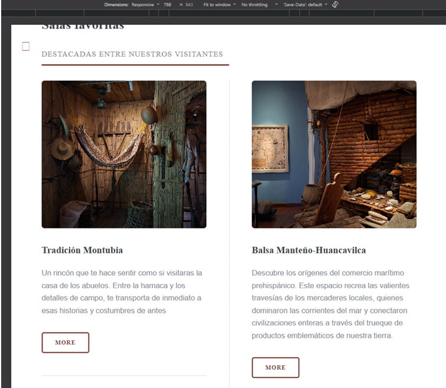
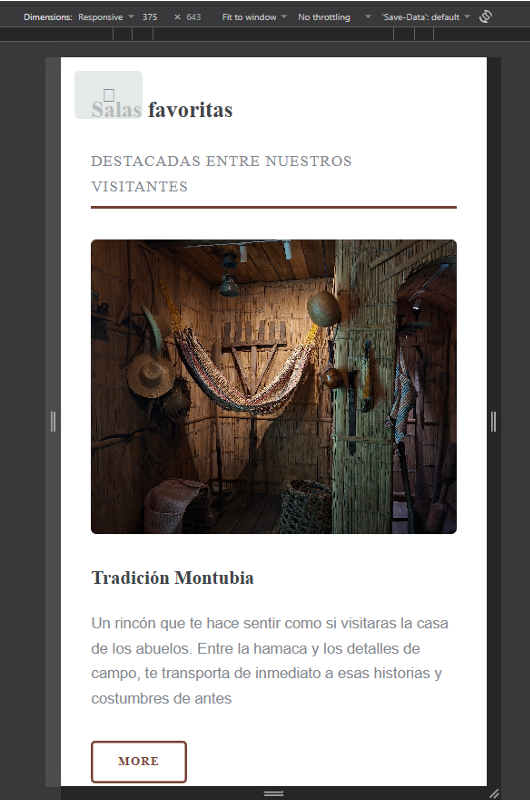

# Landing Page – Museo Nacional del Cacao (Guayaquil)

**Proyecto 02: Explorando la cultura con la web**
Desarrollo de aplicaciones web y móvil (DAWM) · Facultad de Ingeniería en Electricidad y Computación · ESPOL

**Integrantes:** Samuel Villagómez · Niurka Roca

🔗 **Sitio publicado:** <https://sam-ai06.github.io/Landing-Page-Museo-del-cacao-GYE/>



---

## Tabla de contenido

1. [Análisis](#1-análisis)
2. [Planificación](#2-planificación)
3. [Diseño](#3-diseño)
4. [Implementación](#4-implementación)
5. [Despliegue](#5-despliegue)
6. [Estructura del repositorio](#6-estructura-del-repositorio)
7. [Bibliografía](#7-bibliografía)

---

## 1. Análisis

### 1.1 Contexto

El Museo Nacional del Cacao es un espacio ubicado en el centro de Guayaquil, en la calle Panamá. Está dedicado a contar el origen ancestral del grano de cacao en el Ecuador y a resaltar su importancia económica y cultural.

El museo ofrece un recorrido por diversas salas que, en conjunto, recopilan más de 4000 años de historia del cacao: desde sus orígenes y la época precolombina, pasando por la colonia, hasta el auge de las exportaciones ecuatorianas a finales del siglo XX.

La página propuesta **no pretende reemplazar** la página oficial del museo. Su objetivo es resaltar los aspectos que, según las entrevistas realizadas a visitantes, resultan más llamativos y justifican la visita, además de funcionar correctamente en distintos dispositivos, desde computadoras de escritorio hasta móviles.

### 1.2 Obtención de información

La información se recopiló mediante investigación sobre el museo y **entrevistas a visitantes**. Con ellas se conocieron sus motivaciones, hábitos de visita, expectativas y las dificultades que pueden aparecer durante el recorrido:

- Algunos visitantes tuvieron dificultad para entender el orden de las salas: la señalética existe, pero es poco visible.
- Hubo dudas sobre si es posible contar con un guía durante la visita.
- La información no está centralizada y resulta poco clara.
- Les gustaría que, además de la visita, hubiera actividades recreativas: teatro, talleres, degustación y actividades temáticas del mes.

### 1.3 Organización del contenido

La página cuenta con 5 secciones:

#### i. Inicio

Capta la atención del usuario y presenta de forma rápida el museo y un poco de su historia. Contiene un titular y una fotografía llamativa tomada en el museo.


#### ii. Origen

Narra el recorrido del cacao desde sus inicios y los temas principales de enfoque del museo: Cultura Mayo-Chinchipe, Cacao Nacional, Epicentro Genético y Uso Precolombino.



#### iii. Salas favoritas

Durante las entrevistas se identificaron las tres salas preferidas por los visitantes. Esta sección las destaca y comenta brevemente cómo las perciben: **Tradición Montubia**, **Balsa Manteño-Huancavilca** y **Sala de la familia**.



#### iv. Guía de la semana

Como muchos visitantes mostraron interés en actividades adicionales dentro del museo, se agregó un apartado donde se publican las actividades de la semana (por ejemplo, la cata de chocolate).



#### v. Visítanos

Reúne los medios de contacto del museo.



| Dato | Información |
|------|-------------|
| Correo | museodelcacao@uni.gob.ec |
| Teléfono | (04) 259-2100 |
| Horario | Martes a domingo, 10:00 a 17:00 |
| Dirección | Calle Panamá, Guayaquil, Ecuador |

### 1.4 Requerimientos derivados de las entrevistas

| Sección | Propósito | Datos que se presentan |
|---------|-----------|------------------------|
| Guía de la semana | Resolver la necesidad de actividades recreativas dentro del museo expresada por los visitantes. | Talleres y recorridos con imágenes e información previa. |
| Inicio | Centralizar la información con contexto previo y el objetivo del museo. | Título de bienvenida, contexto breve y una imagen llamativa. |
| Origen | Estructurar los 4 temas principales del museo para guiar al usuario sobre la secuencia de las salas. | 4 bloques con información de: Cultura Mayo-Chinchipe, Cacao Nacional, Epicentro Genético y Uso Precolombino. |
| Salas favoritas | Invitar e incentivar a nuevos usuarios a visitar el museo. | Ubica las 3 salas destacadas: Tradición Montubia, Balsa Manteño-Huancavilca y Sala de la familia. |
| Visítanos | Facilitar de forma clara los datos de contacto del museo para resolver dudas de los visitantes. | Ubicación exacta, horarios de atención, correo y teléfono directo. |

---

## 2. Planificación

### Herramientas de trabajo

| Herramienta | Uso |
|-------------|-----|
| **GitHub** | Alojamiento del repositorio y control de versiones. |
| **Visual Studio Code** | Editor de texto principal para construir la página. |
| **Live Server** | Extensión de VS Code para previsualizar la página mientras se hacen cambios. |

### Integrantes y roles

| Integrante | Rol |
|------------|-----|
| Samuel Villagómez | Búsqueda de la plantilla y desarrollo de la sección de presentación de la página. |
| Niurka Roca | Desarrollo de la galería de imágenes y modificación del menú de navegación. |

---

## 3. Diseño

### 3.1 Tabla comparativa de diseños potenciales

| | Diseño 1 | Diseño 2 | Diseño 3 |
|---|----------|----------|----------|
| **Plantilla** | [Editorial](https://html5up.net/editorial) | [Forty](https://html5up.net/forty) | [Future Imperfect](https://html5up.net/future-imperfect) |
| **Sección principal** | Título, imagen lateral y descripción. | Banner principal con imagen de fondo, título por encima y un breve mensaje como subtítulo. | Banner que inicia con logo y el título de la plantilla. |
| **Navegación** | Lateral izquierda, desplegable y *responsive*. | Superior, fija por defecto; no se puede plegar ni desplegar. | Superior, fija por defecto; no se puede plegar ni desplegar. |
| **Galería** | Cada imagen tiene subtítulo y descripción breve; ideal para presentar las salas relevantes. | Mosaico de imágenes; al hacer clic se abre una página dedicada. | Un `div` por imagen con descripción breve y un botón hacia su página dedicada. |

### 3.2 Plantilla elegida y justificación

Se eligió la plantilla HTML **Editorial** de HTML5 UP.

Su página inicial propone un título, una descripción y una imagen que la complementa, lo que resultó ideal para migrar la información de la sección principal existente. Además, se reemplazó la galería de imágenes con descripción por las **salas que los entrevistados consideraron más cautivadoras e interesantes**, de modo que la información queda concentrada en la misma página, pero en una sección distinta de la principal.

---

## 4. Implementación

### Personalización de la plantilla

Sobre la plantilla Editorial se adaptaron el menú lateral (Inicio, La historia, Salas del museo, Visítanos), la presentación, la sección Origen, la galería de salas favoritas, la Guía de la semana y los datos de contacto.



---

## 5. Despliegue

El sitio se publica con **GitHub Pages** desde la rama `main`, carpeta raíz (`/ (root)`).

🔗 <https://sam-ai06.github.io/Landing-Page-Museo-del-cacao-GYE/>

### Pruebas en distintas pantallas

Se verificó el comportamiento *responsive* con las herramientas de desarrollo del navegador.

**Tablet (768 px)**



**Móvil (375 px)**



---

## 6. Estructura del repositorio

```text
Landing-Page-Museo-del-cacao-GYE/
├── index.html          # Página principal (en la raíz, requerido por GitHub Pages)
├── README.md           # Documentación del proyecto
└── docs/
    └── img/            # Capturas usadas en este README
        ├── galeria.png
        ├── guiaSemana.png
        ├── main.png
        ├── movil.png
        ├── origen.png
        ├── salasfavs.png
        ├── tablet.png
        └── visitanos.png
```

> Los demás archivos (CSS, JavaScript, imágenes de la plantilla) siguen la estructura propia de la plantilla Editorial.

---

## 7. Bibliografía

- HTML5 UP. *Editorial*. <https://html5up.net/editorial>
- HTML5 UP. *Forty*. <https://html5up.net/forty>
- HTML5 UP. *Future Imperfect*. <https://html5up.net/future-imperfect>
- Entrevistas realizadas a visitantes del Museo Nacional del Cacao, Guayaquil.  